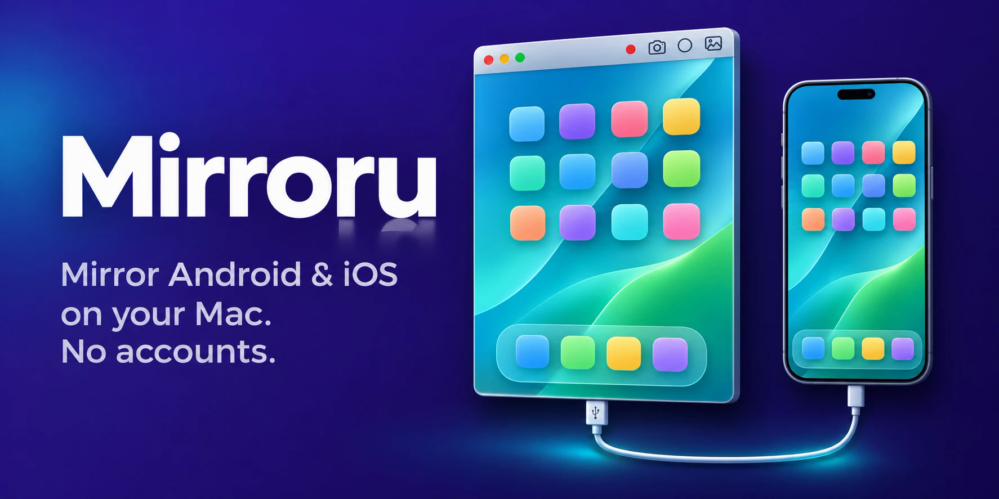
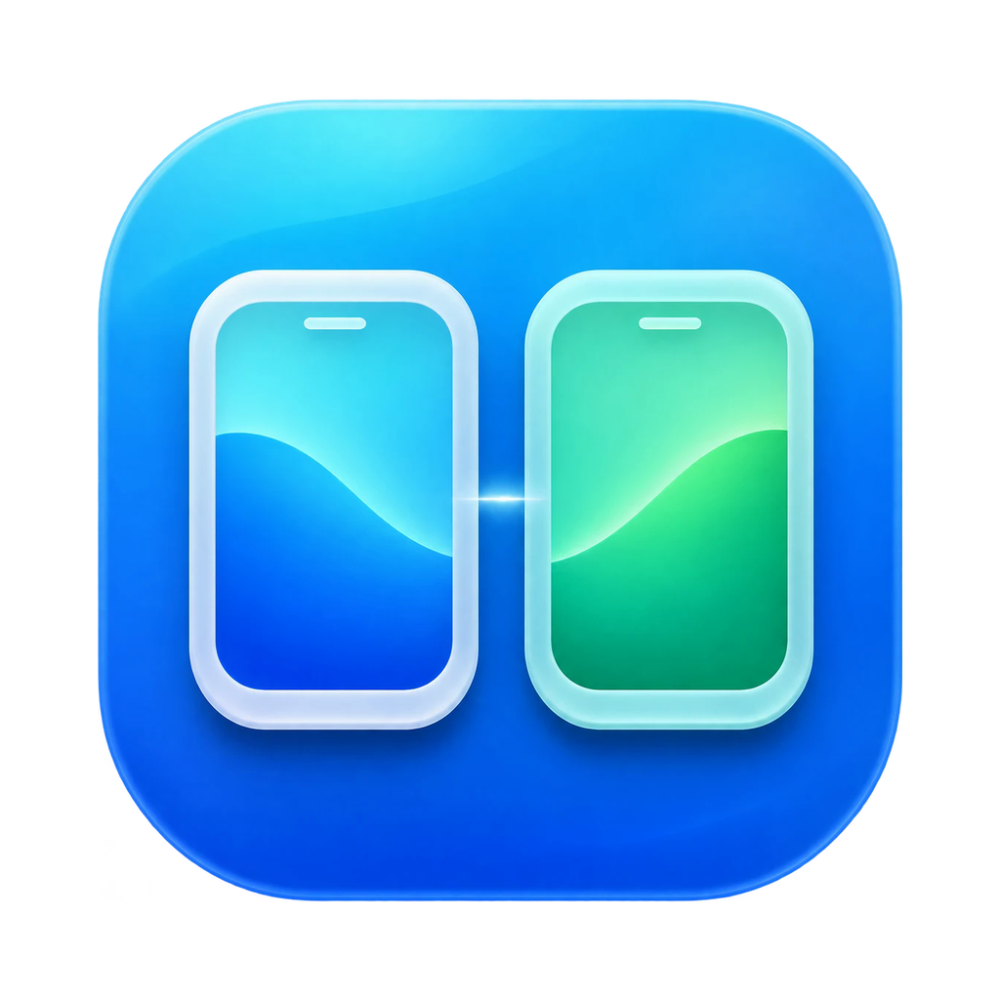

<p align="center"></p>

#  Mirroru

Espejo de Android e iOS por USB para macOS, lanzado desde un CLI. Sin cuentas, sin iCloud y sin instalar nada en el teléfono. La ventana imita al Simulador de Xcode: nombre del dispositivo arriba y botones de captura, video y GIF.

| | Ver | Captura / video / GIF | Control |
|---|---|---|---|
| **Android** | sí | sí | toque, deslizar, teclado, Inicio/Atrás/Recientes |
| **iOS** | sí | sí | no (iOS no permite inyectar toques) |

## Instalar

```bash
scripts/build.sh --install
```

Crea `build/Mirroru.app` (con su icono) y enlaza el comando `mirroru` en `/usr/local/bin` o `~/.local/bin`.
Requiere macOS 14+, Xcode (Swift) y, para Android, `adb`.

## Uso

```bash
mirroru                     # abre una ventana por cada dispositivo conectado
mirroru devices             # lista dispositivos
mirroru open -d ios         # solo el iPhone  (-d acepta serial, nombre o android/ios)
mirroru screenshot -o a.png # captura sin abrir ventana
mirroru record -t 10        # video de 10 s (o Ctrl-C para terminar)
mirroru gif -t 5            # GIF de 5 s
mirroru open --demo         # fuente sintética, para probar sin teléfono
```

En la ventana: **⌘S** captura, **⌘R** video, **⌘G** GIF. Los archivos van al Escritorio.
En Android: clic = toque, clic largo = pulsación larga, arrastrar = deslizar, rueda = scroll,
clic derecho o Esc = Atrás, ⇧⌘H Inicio, ⇧⌘A recientes, ⌘L bloquear, teclado = texto.

## Modo privado

La ventana arranca difuminada, para no enseñar tus apps ni tus notificaciones mientras proyectas o grabas.
El difuminado se aplica también a capturas, video y GIF: lo que no se ve en la ventana no queda en ningún archivo.

- **⌘K** abre un buscador con las apps del teléfono. Al elegir una, Mirroru la abre en el dispositivo y la muestra.
  El interruptor **Solo en desarrollo** deja en la lista únicamente las apps instaladas desde Xcode (iOS) o
  depurables (Android), para que las de la tienda no se vean mientras compartes.
- **⌘P** muestra u oculta toda la pantalla.
- *Privacidad › Iniciar en modo privado* decide si las ventanas nuevas arrancan difuminadas.

| | Android | iOS |
|---|---|---|
| Lista de apps | con icono de lanzador; el nombre se deduce del paquete | con nombre e icono (necesita el modo de desarrollador) |
| Al elegir una app | se muestra solo mientras esa app está al frente | se muestra mientras sigues en ella |
| Al salir y volver | se oculta y se muestra sola | se oculta sola; se muestra sola si la app vuelve con el mismo aspecto |

La app elegida se recuerda por dispositivo: la próxima vez aparece la primera del buscador (⌘K, Intro).

iOS no dice qué app está al frente; solo avisa de que se cambió de app. Al recibir ese aviso Mirroru vuelve al modo
privado y guarda cómo se veía tu app (conserva varias pantallas, tomadas en momentos de calma). Tras cada cambio posterior compara la pantalla con esa imagen y, si coincide,
la muestra de nuevo. Es una comparación estricta: si la app vuelve con otro contenido, o su pantalla era casi lisa,
se queda oculta y hay que elegirla otra vez.
La noticia de que saliste de la app llega unas décimas tarde (un aviso en iOS, la siguiente consulta en Android).
Para que ese instante no se vea ni quede grabado, mientras sigues una app la imagen va con 0,8 s de retraso: los
cuadros de la transición aún no han salido cuando llega la noticia, y salen ya difuminados. En Android eso
significa que tus toques desde la ventana también se ven con ese retraso. Con «Mostrar todo» no hay retraso.

Un iPhone sin modo de desarrollador (*Ajustes › Privacidad y seguridad › Modo de desarrollador*) muestra toda la
pantalla desde el principio; ⌘P sigue funcionando. Los comandos sin ventana (`screenshot`, `record`, `gif`) no difuminan.

## Preparar el teléfono

- **iPhone / iPad**: conéctalo por cable, desbloquéalo y pulsa «Confiar». La primera vez macOS pedirá
  permiso de **Cámara** para Mirroru: así expone Apple la pantalla por USB (el mismo mecanismo que
  QuickTime). No se usa ninguna cámara. Mientras se captura, iOS muestra 9:41 en la barra de estado.
- **Android**: activa *Opciones de desarrollador › Depuración USB* y acepta la huella del Mac.

Los comandos sin ventana (`screenshot`, `record`, `gif`) con iOS usan el permiso de Cámara de tu terminal.

## Cómo funciona

- `IOSSource`: activa los dispositivos de captura de pantalla de CoreMediaIO y lee cuadros con AVFoundation.
- `AndroidSource`: `adb exec-out screenrecord` (H.264) decodificado con VideoToolbox; la entrada va por
  `adb shell input`. Las capturas de Android usan `screencap` (PNG sin pérdida).
- `Fingerprint`: una copia de 40 × 80 px de un cuadro, para reconocer una pantalla ya vista (el regreso a la app en iOS).
- `FrameHub` reparte cada cuadro a la ventana, al grabador de video (AVAssetWriter, .mp4) y al de GIF (ImageIO).
  En modo privado difumina el cuadro antes de repartirlo.
- `Companion`: lo que el teléfono cuenta además de su imagen. En iOS usa `xcrun devicectl` (apps, iconos, abrir
  una app, estado de bloqueo y avisos de cambio de app); en Android usa `adb` (apps, abrir una app, app al frente).

## Límites conocidos

- Sin audio.
- El control de Android usa `input`, que tarda unas décimas por gesto; no hay arrastre continuo ni multitáctil.
- `screenrecord` se reinicia cada 3 min (un parpadeo imperceptible) y solo envía cuadros cuando la pantalla cambia.
- En modo privado los banners de notificación que aparecen sobre una app visible no se tapan: usa No molestar.
- Los GIF se limitan a 600 cuadros (~50 s) a 12 fps y 360 px de ancho.

## Licencia

[MIT](LICENSE)
